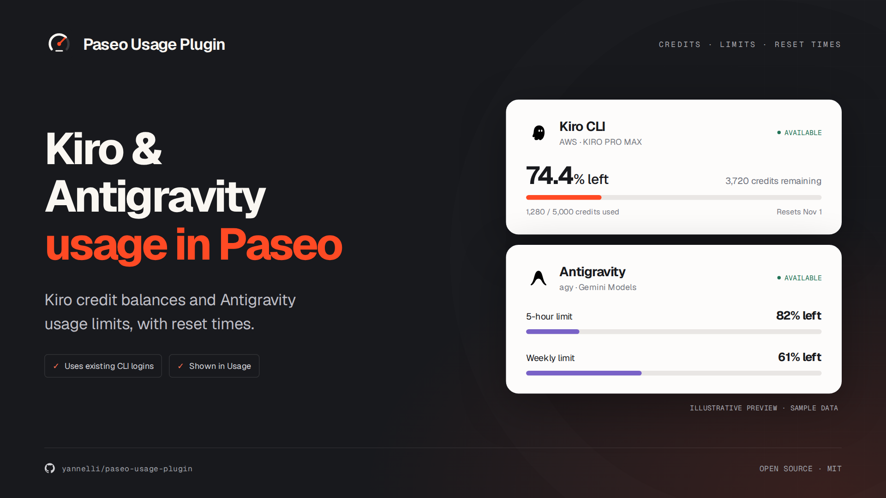
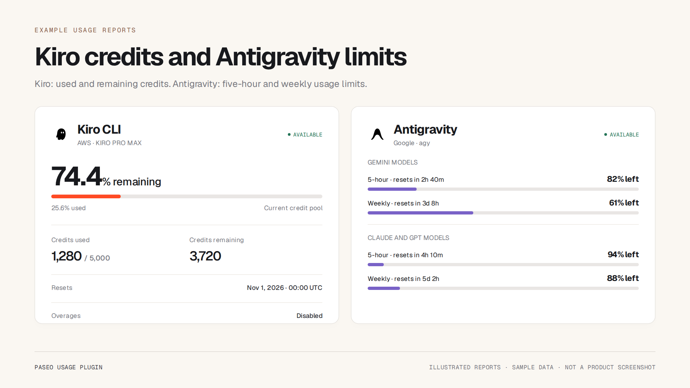

# Paseo Usage Plugin

[](https://github.com/yannelli/paseo-usage-plugin/actions/workflows/checks.yml)
[](https://github.com/yannelli/paseo-usage-plugin/releases)
[](https://www.npmjs.com/package/@yannelli/paseo-usage-plugin)
[](https://paseo.sh)
[](LICENSE)

`paseo-usage-plugin` shows **Kiro CLI (AWS) credit balances** and **Antigravity CLI (`agy`) usage limits** in Paseo's Usage view and agent popovers. Reports include remaining allowances and reset times, using your existing CLI logins.

| Provider | What you see |
| --- | --- |
| **Kiro CLI** | Used and remaining credits, plan, reset date, active trial and bonus balances, reported overage charges |
| **Antigravity** | Shared five-hour and weekly limits for Gemini and other model groups, with reset times and legacy per-model fallback |

## Install

```sh
paseo plugin install npm:@yannelli/paseo-usage-plugin
```

Enable plugins in **Settings → Plugins**, then open **Usage**. Sign in to each CLI on the **daemon host**, where this plugin runs.

Requires **Paseo 0.11.2+** and **Node 22.13+**. Tested on Linux with Kiro CLI **2.29.1** and Antigravity CLI **1.3.3**. Paseo supplies all runtime dependencies.

```sh
paseo plugin ls paseo-usage-plugin
paseo plugin update paseo-usage-plugin
```

GitHub installation is also supported:

```sh
paseo plugin install git:yannelli/paseo-usage-plugin
```

For a fixed GitHub release, add `--ref <release-tag>`. Use a tag from [Releases](https://github.com/yannelli/paseo-usage-plugin/releases). The runtime plugin ID remains `paseo-usage-plugin` for either install source.

## Usage reports



*Graphics are illustrations with sample data, not product screenshots. The actual layout is provided by Paseo.*

- **Usage view and agent popovers.** Both show reports from the same usage sources.
- **Account selection.** Each agent uses the CLI account selected by its launch environment. Account identities remain stable when tokens rotate.
- **Reset periods.** Five-hour and weekly limits use the periods reported by the provider. The plugin does not infer an unknown period from its reset countdown.
- **Credential access.** The plugin reads stored access tokens. It never refreshes them, changes login files, or starts an agent.
- **Login errors.** Expired or rejected logins show how to sign in again. Other accounts continue reporting usage.

## Configuration

Default credential locations on Linux:

| Provider | Store | Optional override |
| --- | --- | --- |
| Kiro | `~/.local/share/kiro-cli/data.sqlite3` (respects `XDG_DATA_HOME`) | `KIRO_USAGE_DB` |
| Antigravity | `~/.gemini/antigravity-cli/antigravity-oauth-token` | `AGY_USAGE_TOKEN_FILE` |

Overrides are absolute file paths in the daemon or agent's launch environment. They select a store for this plugin; they do not change the CLI's login. Usage is cached by Paseo for five minutes, with manual refresh available.

The supported accounts are local CLI OAuth logins. API-key/ADC accounts, remote Antigravity language servers, custom gateways, and IDE-only credentials are not supported. These are internal CLI quota endpoints, so future upstream changes may require adapter updates.

[Credential details, quota semantics, and troubleshooting →](docs/configuration.md)

## Development

```sh
git clone https://github.com/yannelli/paseo-usage-plugin.git
cd paseo-usage-plugin
npm ci
npm run check
paseo plugin install "$PWD"
```

`npm run check` runs typechecking and the offline tests. `npm run check:live` explicitly fetches the configured accounts' real quotas. After changes, run `paseo plugin reload paseo-usage-plugin`.

| Guide | Contents |
| --- | --- |
| [Configuration](docs/configuration.md) | Credential stores, account isolation, request behavior, troubleshooting |
| [Development](docs/development.md) | Validation, packaging, local testing, reproducible graphics |
| [Releases](docs/releases.md) | Conventional Commits, automatic npm and GitHub releases, versioning |
| [npm publishing](docs/npm-publishing.md) | Trusted publishing, provenance, bootstrap, and recovery |

## Releases and license

Checks run on Node 22 and 24. Qualifying pushes to `main` publish a public npm package with provenance and create a GitHub release with the same installable package attached. GitHub Actions authenticates to npm through a trusted publisher, without a stored npm token. `fix:` makes a patch release, `feat:` makes a minor release, and a breaking change makes a major release. Documentation-only changes do not bump the version. [Release details →](docs/releases.md)

[MIT](LICENSE) · Made by [Ryan Yannelli](https://ryanyannelli.com). Questions or feedback? [Open an issue](https://github.com/yannelli/paseo-usage-plugin/issues).
